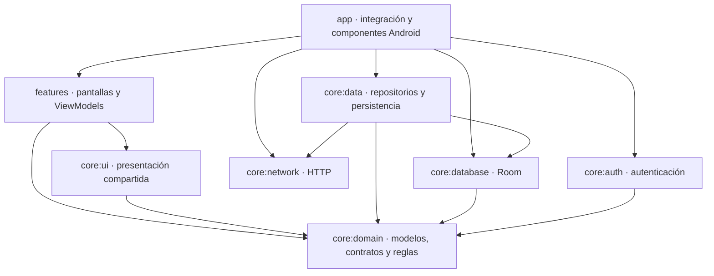

# BarberApp

Aplicación Android para gestionar la relación entre clientes y barberos: publicación de trabajos, reservas de turnos, organización de la agenda y consulta de ganancias. Desarrollada en Kotlin con Jetpack Compose, una arquitectura modular por capas y persistencia local para consultar información previamente sincronizada.

El proyecto contempla dos perfiles con navegación y permisos diferenciados. Las reservas se confirman mediante transacciones de Cloud Firestore y sus reglas de seguridad. La implementación actual no requiere Cloud Functions ni un plan Firebase Blaze.

**NOTA: La aplicacion cuenta con un usuario barbero registrado en la base de datos. Por otro lado, los usuarios que utilizan la opcion de registrarse se generan con el rol de cliente. La cuenta de barbero es nisca@gmail.com / Contraseña:619200.**
## Contenido

- [Funcionalidades](#funcionalidades)
- [Arquitectura y responsabilidades](#arquitectura-y-responsabilidades)
- [Estructura del repositorio](#estructura-del-repositorio)
- [Tecnologías](#tecnologías)
- [Reservas y disponibilidad](#reservas-y-disponibilidad)
- [Persistencia y funcionamiento sin conexión](#persistencia-y-funcionamiento-sin-conexión)
- [Notificaciones y recordatorios](#notificaciones-y-recordatorios)
- [Instalación y configuración](#instalación-y-configuración)
- [Pruebas y verificación](#pruebas-y-verificación)
- [Alcance y limitaciones](#alcance-y-limitaciones)
- [Documentación complementaria](#documentación-complementaria)

## Funcionalidades

### Cliente

- Registro e inicio de sesión con correo y contraseña o cuenta de Google.
- Consulta de publicaciones con fotografías y descripciones de trabajos realizados.
- Inicio de una reserva desde una publicación, con su barbero seleccionado.
- Selección de barbero, servicio, día e intervalo disponible de esta semana o la próxima.
- Incorporación de una fotografía de referencia para el corte al reservar o modificar un turno.
- Consulta, modificación y cancelación de sus propios turnos, según su estado y horario.
- Lectura sin conexión de turnos, publicaciones e imágenes previamente guardados.
- Recordatorios locales antes del turno y avisos de cancelaciones realizadas por el barbero.
- Visualización de la ubicación de la barbería y cálculo de un recorrido desde la ubicación actual o un origen elegido en el mapa.

### Barbero

- Consulta de sus turnos con filtros de semana y estado.
- Alta y edición de servicios: nombre, precio, duración y disponibilidad para nuevas reservas.
- Desactivación de servicios conservando el historial de turnos.
- Configuración y publicación de franjas de atención para esta semana y la próxima.
- Cancelación de turnos futuros y registro de turnos realizados desde su hora de inicio.
- Consulta de reportes semanales y mensuales de ganancias a partir de los turnos realizados.
- Publicación de fotografías desde la cámara o la galería, edición de la descripción y eliminación de publicaciones propias.
- Configuración de su perfil, zona horaria y ubicación de la barbería.
- Lectura sin conexión de sus turnos y cálculo del reporte con la información local disponible.
- Avisos locales sobre cambios en sus reservas.

### Preferencias de interfaz

La aplicación ofrece español e inglés, selección de apariencia clara u oscura y conservación de las preferencias. La navegación presenta las opciones correspondientes al rol validado de la cuenta.

## Arquitectura y responsabilidades

La aplicación utiliza **MVVM en presentación**, casos de uso para ejecutar las operaciones del dominio y repositorios para abstraer el acceso a datos. Hilt construye el grafo de dependencias; las implementaciones se vinculan con sus contratos mediante módulos de inyección.

| Módulo | Responsabilidad |
|---|---|
| `:app` | Punto de entrada, configuración de la aplicación, navegación, composición de dependencias y coordinación de la sesión. Aloja los servicios Android, WorkManager, alarmas y la construcción de Room para Android. |
| `:core:domain` | Modelos, contratos de repositorios, políticas, validaciones y casos de uso en Kotlin/JVM. Define las reglas de reservas, las acciones disponibles de un turno, la detección de cambios, los reportes y el cálculo de recordatorios. |
| `:core:data` | Implementaciones de repositorios, consultas y transacciones de Firestore, sincronización con Room, preferencias, acceso al GPS y manejo de archivos e imágenes. Traduce errores técnicos a resultados de dominio. |
| `:core:database` | Base Room, entidades, DAO, mappers y migraciones. Es un módulo Kotlin/JVM: recibe la construcción de la base desde la plataforma que lo utiliza. |
| `:core:network` | Clientes HTTP, contratos Retrofit, DTO y operaciones de red para Cloudinary y OSRM. |
| `:core:auth` | Implementación de autenticación con Firebase Authentication y adaptación de la identidad de la sesión al contrato de dominio. |
| `:core:ui` | Tema, preferencias expuestas a la interfaz, componentes reutilizables, presentación de mapas, permisos y traducción de errores a recursos de texto. |
| `:core:testing` | Herramientas compartidas de pruebas: repositorios simulados, datos y reglas de dispatchers. Sus consumidores lo incorporan mediante `testImplementation`. |
| `:features:auth` | Pantallas y estado de inicio de sesión y registro; interacción con el selector de cuentas de Google. |
| `:features:home` | Presentación y edición de publicaciones, selección de fotografías y estado del borrador. |
| `:features:turnos` | Pantallas y ViewModels de reservas, turnos, agenda y recorrido hacia la barbería. |
| `:features:cuenta` | Pantallas y ViewModels de cuenta, servicios, ubicación y ganancias. |
| `:features:notifications` | Solicitud del permiso de notificaciones y presentación de avisos mediante los componentes de Android. |

### Dirección de las dependencias

El código principal de dominio no depende de Android, Firebase, Room, Retrofit ni de las features. Las features utilizan dominio y componentes de interfaz; las implementaciones de datos quedan vinculadas desde Hilt.



El diagrama representa las dependencias principales de producción. `core:testing` queda fuera de ese flujo: sus utilidades se comparten entre las pruebas de los módulos.

### Flujo de una operación

1. La pantalla comunica una acción al ViewModel.
2. El ViewModel invoca un caso de uso y publica su estado observable.
3. Dominio aplica las reglas correspondientes y utiliza un contrato de repositorio cuando necesita datos.
4. La implementación resuelta por Hilt realiza la operación remota o local y adapta su resultado.
5. La interfaz representa el estado y obtiene los textos desde sus recursos de idioma.

Por ejemplo, `EvaluarAccionesTurnoUseCase` determina las acciones disponibles de un turno utilizando `PoliticaReservas`. `TurnoListViewModel` entrega ese resultado a `TurnosListScreen`, que lo utiliza para presentar los controles. Las transacciones de datos vuelven a comprobar el estado vigente y las reglas de Firestore verifican la autorización y la integridad de la escritura.

## Estructura del repositorio

```text
unaj-am/
├── app/                    # Aplicación Android, navegación, sesión y servicios
├── core/
│   ├── auth/               # Adaptadores de Firebase Authentication
│   ├── data/               # Repositorios, sincronización y acceso a recursos
│   ├── database/           # Room: entidades, DAO, mappers y migraciones
│   ├── domain/             # Modelos, contratos, políticas y casos de uso
│   ├── network/            # Clientes HTTP, API y DTO
│   ├── testing/            # Utilidades reutilizables para pruebas
│   └── ui/                 # Tema, componentes, mapas y mensajes
├── features/
│   ├── auth/               # Acceso y registro
│   ├── cuenta/             # Cuenta, servicios, ubicación y ganancias
│   ├── home/               # Publicaciones
│   ├── notifications/      # Permiso y presentación de avisos
│   └── turnos/             # Reservas, listado, agenda y recorrido
├── firestore-tests/        # Pruebas de reglas y transacciones con emulador
├── docs/                   # Documentación de funcionalidades y decisiones
├── gradle/                 # Wrapper, catálogo de versiones y JVM de Gradle
├── firebase.json           # Configuración de reglas y emulador Firestore
├── firestore.rules         # Autorización y validación de datos remotos
├── settings.gradle.kts     # Registro de módulos
└── README.md
```

Las pruebas permanecen junto al código que verifican:

- `src/main`: código principal de cada módulo.
- `src/test`: pruebas locales de dominio, repositorios, persistencia y ViewModels.
- `src/androidTest`: pruebas que requieren Android, como Compose, recursos y la integración de la aplicación.
- `core/testing/src/main`: utilidades exportadas para que otros módulos las utilicen desde sus pruebas; no contiene todas las suites del proyecto.

## Tecnologías

| Área | Tecnología y uso |
|---|---|
| Lenguaje y construcción | Kotlin 2.4.20, Gradle Wrapper 9.7.1, Android Gradle Plugin 9.4.1 y scripts Kotlin DSL. |
| Interfaz | Jetpack Compose, Material 3, Compose BOM `2026.09.00` y AppCompat para preferencias de idioma. |
| Estado y concurrencia | ViewModel, SavedStateHandle, Lifecycle, Kotlin Coroutines y Flow. |
| Navegación | Navigation 3, destinos serializables y conservación del estado por entrada de navegación. |
| Inyección de dependencias | Dagger Hilt 2.60.1 y procesamiento de código con KSP. |
| Autenticación | Firebase Authentication, Credential Manager y Google Identity. |
| Datos remotos | Cloud Firestore y reglas de seguridad versionadas en el repositorio. |
| Persistencia local | Room 3.0.3, SQLite Bundled y preferencias privadas para configuraciones y estado auxiliar. |
| Imágenes | Cloudinary para alojamiento, Coil 3 para presentación y FileProvider para capturas temporales. |
| Red | Retrofit 3, OkHttp y Kotlin Serialization. |
| Mapas y recorridos | MapLibre Native 13.6.1, mosaicos de OpenStreetMap y API de OSRM con perfil de conducción. |
| Trabajo en segundo plano | WorkManager para consultas periódicas y AlarmManager para recordatorios locales. Firebase Messaging permanece integrado como receptor de mensajes. |
| Pruebas | JUnit 4, coroutines-test, Mockito, Compose UI Test, AndroidX Test y Firebase Rules Unit Testing con el emulador de Firestore. |

Las versiones configuradas se consultan en [`gradle/libs.versions.toml`](gradle/libs.versions.toml) y en los archivos `build.gradle.kts` de cada módulo.

## Reservas y disponibilidad

Los servicios admiten duraciones enteras de **5 a 240 minutos**. La disponibilidad se calcula con la duración del servicio seleccionado, las franjas publicadas, los descansos, los cierres y las reservas existentes.

- Se ofrecen esta semana y la próxima, de lunes a sábado, según la zona horaria del barbero.
- Cada opción representa un intervalo completo. Las opciones ofrecidas para un mismo servicio se distribuyen sin superponerse entre sí.
- Una reserva debe entrar completamente en una franja de atención disponible.
- La confirmación actualiza el turno y su ocupación en una misma transacción. Dos reservas concurrentes no pueden confirmar los mismos minutos.
- La modificación conserva la identidad y la fecha de creación del turno. Si la operación falla, se conserva la reserva anterior.
- La cancelación libera su intervalo completo. Los turnos pendientes futuros pueden modificarse o cancelarse según el rol autorizado.
- Un barbero puede registrar un turno como realizado desde su hora de inicio. El importe cobrado se conserva para los reportes.
- Cambiar la duración de un servicio no cambia automáticamente las fechas de turnos existentes. Una selección de horario desactualizada debe consultarse nuevamente.
- Guardar una agenda y publicarla son operaciones distintas. Al republicar, se cancelan las reservas futuras excluidas de las nuevas franjas.

`OcupacionDia` representa los minutos de atención y ocupación de cada día. Firestore conserva esa información en `disponibilidad`, sin almacenar allí nombres ni identificadores de clientes. Las reglas validan los cambios exactos de ocupación junto con la operación del turno.

### Organización de datos remotos

| Ruta | Contenido principal |
|---|---|
| `clientes/{uid}` | Perfil del cliente asociado a su identidad de Authentication. |
| `barberos/{uid}` | Perfil, habilitación, zona horaria y ubicación de la barbería. |
| `barberos/{uid}/agenda/{agendaId}` | Configuración de atención de la semana. |
| `barberos/{uid}/dispositivos/{instalacionId}` | Registro opcional del token FCM de la instalación. |
| `servicios/{servicioId}` | Propietario, nombre, precio, duración y estado del servicio. |
| `turnos/{turnoId}` | Participantes, servicio, fechas, estado, referencia fotográfica e información de realización o cancelación. |
| `disponibilidad/{diaId}` | Atención publicada y ocupación por minutos de un barbero y un día. |
| `publicaciones/{publicacionId}` | Datos del trabajo publicado y referencias de su imagen en Cloudinary. |

Las reglas conservan compatibilidad con registros anteriores. La implementación actual utiliza la disponibilidad por minutos de la versión de reservas 3.

## Persistencia y funcionamiento sin conexión

Room mantiene una copia local de la información confirmada por el servidor. La base actual tiene **versión 3** y dispone de migraciones para incorporar publicaciones y la referencia de imagen del turno conservando los registros existentes.

| Información u operación | Cliente | Barbero |
|---|---|---|
| Consulta de turnos previamente sincronizados | Disponible con Room. | Disponible con Room, limitada a sus propios turnos. |
| Consulta de publicaciones y fotografías descargadas | Disponible mediante metadatos en Room y archivos privados. | Sin descarga persistente de publicaciones gestionada por esta funcionalidad. |
| Reporte de ganancias | No corresponde al rol. | Puede calcularse con los turnos realizados e importes locales disponibles. |
| Reservar, modificar, cancelar o completar un turno | Las acciones autorizadas requieren confirmación remota. | Las acciones autorizadas requieren confirmación remota. |
| Publicar trabajos, guardar servicios, ubicación o publicar agenda | No corresponde al rol. | Requiere conexión. |

Las imágenes de las publicaciones del cliente se descargan durante la sincronización. Room guarda los metadatos y la ruta del archivo; los bytes de la imagen se guardan en `noBackupFilesDir/publicaciones`, dentro del almacenamiento privado de la aplicación. No se guardan como BLOB ni se agregan a la galería del dispositivo.

El acceso sin conexión requiere una sesión existente y un rol previamente validado con conexión. Ante un error de sincronización se conserva la información local y se informa el estado al usuario. Al cerrar sesión se limpian los datos asociados a esa cuenta y se invalidan las sincronizaciones pendientes.

**No existe una cola de reservas offline:** una solicitud nueva sin conexión no queda confirmada ni se envía automáticamente al recuperar Internet. Las cachés de Firestore, Coil o del SDK de mapas pueden conservar otros recursos, pero no sustituyen el almacenamiento local administrado por la aplicación.

## Notificaciones y recordatorios

### Recordatorios del cliente

Los turnos elegibles generan avisos locales **24 horas y 1 hora antes**. Se programan únicamente los instantes que todavía no pasaron. El usuario puede desactivarlos y reactivarlos por turno.

La configuración de anticipaciones se define en dominio, junto a los modelos de recordatorios. Android programa las alarmas y presenta las notificaciones. Los avisos dependen de los permisos, el canal de notificaciones y los ajustes del sistema; no equivalen a una alarma continua de la aplicación Reloj.

### Avisos por cambios de turnos

La aplicación escucha cambios mientras el proceso está activo y utiliza WorkManager para consultas periódicas con conexión, con un intervalo mínimo de 15 minutos sujeto a la planificación de Android. El barbero recibe avisos sobre cambios relevantes y el cliente sobre cancelaciones realizadas por el barbero.

La primera lectura establece una base sin notificar el historial completo. Las firmas guardadas por cuenta y la normalización de estados históricos permiten comparar los cambios posteriores.

Firebase Messaging conserva la recepción de mensajes y el registro de tokens. **El repositorio no incluye un backend emisor de notificaciones push**: guardar un token no envía mensajes. Los avisos por cambios del flujo actual son locales y dependen de la sincronización, por lo que no se garantiza una entrega inmediata con la aplicación cerrada.

## Instalación y configuración

### 1. Requisitos

- Android Studio compatible con las versiones de Gradle, AGP y Kotlin declaradas en el proyecto.
- JDK 21 para el daemon de Gradle, configurado en `gradle/gradle-daemon-jvm.properties`.
- Android SDK Platform 37.
- Dispositivo o emulador con **Android 8.0 / API 26 o superior**. `compileSdk` y `targetSdk` son 37.
- Acceso a un proyecto Firebase y configuración de Cloudinary para probar las operaciones remotas.
- Google Play Services para verificar el ingreso con Google.
- Node.js 22 y pnpm si se ejecutan las pruebas del emulador de Firestore.

### 2. Abrir el proyecto

Clonar el repositorio, abrir su directorio raíz en Android Studio y sincronizar Gradle. Se utiliza el Wrapper incluido; no hace falta instalar una distribución global de Gradle.

Android Studio configura la ruta del SDK en `local.properties`. Este archivo es específico de cada equipo y está excluido de Git.

### 3. Configurar Firebase

1. Utilizar la configuración de desarrollo incluida en `app/google-services.json` o reemplazarla por la del proyecto propio, correspondiente al identificador Android `ar.edu.unaj.am.myapplication`.
2. Habilitar los proveedores de Authentication **Correo electrónico/contraseña** y **Google**, según los métodos que se vayan a probar.
3. Para Google, registrar la huella de la firma usada en ese equipo y descargar la configuración actualizada. El archivo debe incluir el cliente OAuth web que permite generar `default_web_client_id`.
4. Crear la base de Cloud Firestore y publicar el contenido de [`firestore.rules`](firestore.rules) en el proyecto correspondiente. Guardar el archivo local o compilar la aplicación no publica reglas remotas.
5. Preparar al menos una cuenta de barbero habilitado para probar ambos roles.

El perfil de cliente se completa desde la aplicación. Las cuentas de barbero deben aprovisionarse desde la administración del entorno: el ID de `barberos/{uid}` debe coincidir con el UID real de Authentication. Como configuración inicial del documento se utilizan, entre otros, estos campos:

```json
{
  "Nombre": "Barbero de demostración",
  "Estado": true,
  "ZonaHoraria": "America/Argentina/Buenos_Aires"
}
```

La aplicación no permite que un cliente se otorgue el rol de barbero. Para consultar la huella de la firma de depuración del equipo:

```powershell
.\gradlew.bat :app:signingReport
```

No se requieren credenciales de servicio, claves Admin ni Cloud Functions dentro de la aplicación. Las reservas y los avisos locales están implementados para funcionar con Firebase Spark, sujetos a sus cuotas de uso.

### 4. Configurar Cloudinary y rutas

Crear un preset de carga **unsigned**, restringido a imágenes JPG y al uso previsto por la aplicación. Configurar los valores públicos en `local.properties`, conservando la línea `sdk.dir` que genera Android Studio:

```properties
cloudinary.cloudName=TU_CLOUD_NAME
cloudinary.uploadPreset=TU_UPLOAD_PRESET

# Opcional: servidor compatible con OSRM. Debe usar HTTPS y terminar en /.
rutas.baseUrl=https://router.project-osrm.org/
```

Los valores de Cloudinary admiten letras, números, guion y guion bajo. Se incorporan a `BuildConfig` al compilar. **No agregar el API secret de Cloudinary ni claves privadas al repositorio o al APK.** Si estos valores no están configurados, no podrá completarse la carga de nuevas imágenes.

### 5. Compilar e instalar

Desde la raíz del repositorio, en PowerShell:

```powershell
.\gradlew.bat :app:assembleDebug
.\gradlew.bat :app:installDebug
```

La instalación requiere un dispositivo o emulador conectado. También se puede ejecutar la configuración `app` desde Android Studio. La APK de depuración se genera en:

```text
app/build/outputs/apk/debug/app-debug.apk
```

En Linux o macOS se utiliza `./gradlew` en lugar de `.\gradlew.bat`; si corresponde, otorgar permiso de ejecución con `chmod +x gradlew`.

### 6. Preparar una demostración

1. Ingresar como barbero habilitado y registrar al menos un servicio activo.
2. Configurar, guardar y publicar la agenda de esta semana o la próxima.
3. Guardar la ubicación de la barbería y publicar un trabajo con fotografía.
4. Ingresar con otra cuenta como cliente y reservar un intervalo disponible.
5. Verificar el turno desde ambas cuentas; probar modificación, cancelación y los estados permitidos.
6. Sincronizar los turnos y las publicaciones del cliente, cerrar la aplicación y volver a abrirla sin conexión conservando la sesión.
7. Para verificar ganancias, registrar un turno como realizado desde su hora de inicio y consultar el período correspondiente.

Las credenciales de las cuentas de demostración deben proporcionarse al evaluador por un canal separado del repositorio.

## Pruebas y verificación

### Pruebas locales

```powershell
.\gradlew.bat test
```

Cubren políticas de reservas, intervalos y concurrencia simulada, estados históricos, reportes, recordatorios, casos de uso, repositorios, persistencia SQLite, archivos y estado de los ViewModels. Las pruebas utilizan implementaciones simuladas o recursos locales y no necesitan escribir en el proyecto Firebase real.

### Pruebas Android

Con un dispositivo o emulador conectado, ejecutar la suite habitual excluyendo el diagnóstico remoto opcional:

```powershell
.\gradlew.bat :app:connectedDebugAndroidTest "-Pandroid.testInstrumentationRunnerArguments.notClass=ar.edu.unaj.am.myapplication.TurnosFirestoreReadTest"
.\gradlew.bat :core:ui:connectedDebugAndroidTest
```

Se verifican, entre otros comportamientos, la lectura offline de turnos con Room real, las preferencias persistentes, los idiomas, la integración de Hilt, los botones según las acciones de dominio y los componentes de mapas.

`TurnosFirestoreReadTest` es un diagnóstico de solo lectura contra el entorno real: requiere habilitación explícita y una sesión de barbero iniciada en el dispositivo. Se ejecuta por separado:

```powershell
.\gradlew.bat :app:connectedDebugAndroidTest "-Pandroid.testInstrumentationRunnerArguments.class=ar.edu.unaj.am.myapplication.TurnosFirestoreReadTest" "-Pandroid.testInstrumentationRunnerArguments.validarFirestoreReal=true"
```

### Reglas y transacciones de Firestore

```powershell
cd firestore-tests
pnpm install --frozen-lockfile
pnpm test
cd ..
```

El script inicia el emulador con el proyecto de demostración `demo-barberia`. Las pruebas verifican autorización, aislamiento entre cuentas, modificaciones de disponibilidad y competencia entre reservas mediante el SDK de cliente. No despliegan reglas ni escriben en el proyecto Firebase de desarrollo.

### Análisis estático

```powershell
.\gradlew.bat :app:lintDebug
```

El informe se genera en `app/build/reports/lint-results-debug.html`. Los informes locales de pruebas se encuentran en `build/reports/tests/` y `build/reports/androidTests/` de los módulos correspondientes.

### Verificación de referencia

En la última verificación local del **27 de octubre de 2026**, la aplicación compiló en depuración y se aprobaron **209 pruebas locales** y **13 pruebas Android de `app`**. El diagnóstico contra Firestore real se excluyó de esa ejecución. Estos resultados corresponden a la versión documentada y no sustituyen las pruebas con servicios configurados y dispositivos físicos.

## Alcance y limitaciones

- El modo offline ofrece lectura de información previamente sincronizada; no confirma operaciones remotas ni permite un primer ingreso sin conexión.
- Las fotografías disponibles offline son las que finalizaron su descarga. La descarga persistente de publicaciones está implementada para clientes.
- Las fotografías se alojan en Cloudinary; Firestore conserva sus referencias y metadatos. Eliminar una publicación no elimina automáticamente el archivo remoto de Cloudinary.
- La carga unsigned utiliza un preset público. Sus restricciones deben configurarse en el proveedor; la aplicación no incluye un servicio de firma de cargas.
- El mapa utiliza mosaicos de OpenStreetMap y el recorrido utiliza, de forma predeterminada, el servidor público de demostración de OSRM. Su disponibilidad depende de esos servicios. No se implementan mapas offline, tráfico en vivo ni navegación por voz.
- WorkManager y las alarmas están sujetos a permisos y restricciones de Android. Los cambios remotos pueden conocerse después de la siguiente sincronización.
- Los reportes utilizan los importes registrados en los turnos realizados; los registros históricos sin importe se identifican por separado. Los montos se expresan en ARS.
- La publicación de reglas, el aprovisionamiento de barberos y la configuración de proveedores externos son tareas de preparación del entorno; no se ejecutan automáticamente al abrir el repositorio.

## Documentación complementaria

- [Reservas, validación y configuración en Spark](docs/validacion-y-reservas.md)
- [Herramientas compartidas de pruebas](docs/testing-compartido.md)
- [Gestión de servicios](docs/gestion-servicios.md)
- [Recordatorios de turnos](docs/recordatorios-turnos.md)
- [Idiomas de la aplicación](docs/idiomas.md)
- [Acceso con Google](docs/login-google.md)

El código, los scripts de construcción y las reglas del repositorio definen la implementación vigente. Este README describe la organización y el comportamiento de la versión actual.
